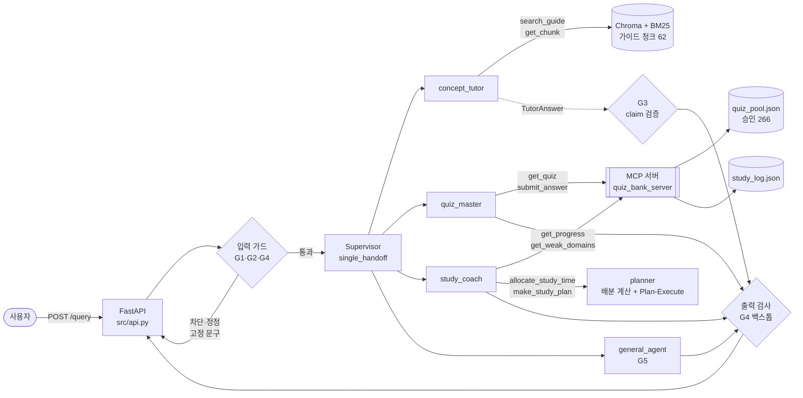

# CCA-F 학습 코치

Claude Certified Architect – Foundations(CCA-F) 시험 준비를 돕는 멀티에이전트 학습 도우미입니다. LangGraph Supervisor와 Amazon Bedrock Claude(Sonnet 4.5)로 만들었습니다.

> **비공식 학습 도구**입니다. Anthropic과 제휴·보증 관계가 없고, 공개된 공식 시험 가이드(v0.2)만 근거로 씁니다. 실제 시험 문항이나 덤프는 다루지 않습니다.

- 기획: [SERVICE.md](SERVICE.md)
- 설계: [docs/DESIGN.md](docs/DESIGN.md)
- 평가: [round1](evaluation/round1_report.md) → [round2](evaluation/round2_report.md)
- 시연: [docs/demo/](docs/demo/)

## 주요 기능

| 기능 | 담당 에이전트 | 예시 질문 |
|---|---|---|
| 개념 질문 (출처 표기, 시험 범위 안내) | concept_tutor | "MCP에서 resource와 tool은 언제 써?" |
| 샘플 문항 해설 | concept_tutor | "가이드 샘플 1번 정답이 왜 A야?" |
| 연습 문제 출제 (검토된 문제 266개, 영어 문항 + 한국어 해설) | quiz_master | "Domain 2에서 문제 하나 내줘" |
| 채점 · 해설 · 풀이 기록 저장 | quiz_master | "B" |
| 진도 · 약점 도메인 조회 | study_coach | "내 약점 도메인 알려줘" |
| 약점 기반 학습 계획 | study_coach | "7일 남았고 하루 2시간, 계획 짜줘" |

## 아키텍처



| 에이전트 | 도구 | 비고 |
|---|---|---|
| concept_tutor | `search_guide`, `get_chunk` | 결과는 `TutorAnswer` 구조화 출력. claim이 이번 턴에 실제로 검색한 doc_id를 가리킬 때만 유효로 보고(G3), `[근거: …]` 표기는 코드가 붙임 |
| quiz_master | `get_quiz`, `submit_answer` (MCP) | `return_direct`로 결과를 코드 서식 그대로 출력. 정답은 LLM 컨텍스트와 State에 넣지 않고 `pending_quiz_id`만 둠 |
| study_coach | `get_progress`, `get_weak_domains` (MCP), `allocate_study_time`, `make_study_plan` | 시간 배분·약점 점수는 코드로 계산. 일자별 계획은 Plan-Execute 서브그래프 |
| general_agent | 없음 | 인사, 기능 안내, 무관한 주제 안내(G5) |

- **런타임 LLM**: `src/llm.py`의 `FallbackChatModel`. 기본은 서울 리전(ap-northeast-2)의 global Sonnet 4.5입니다(v2-6). 쓰로틀링 같은 일시 오류가 나면 Sonnet 4.5의 다른 프로필·리전 → Sonnet 4.6 순으로 전환합니다.
- **입력 가드 LLM 판별은 그래프와 병렬로 돕니다 (v2-2).** 규칙 검사에 걸리면 그래프를 부르지 않습니다. 규칙을 통과하면 LLM 판별과 그래프를 함께 시작하되, 모든 앱 도구는 판별이 통과할 때까지 기다립니다. LLM이 차단하면 그래프를 취소하고 이번 턴 메시지를 되돌리므로, 차단된 요청에서는 도구가 한 번도 실행되지 않습니다.
- **문제는 런타임에 만들지 않습니다.** 오프라인에서 미리 생성하고 검토한 풀에서만 출제하고, 풀에 없는 조합이면 대체 문제를 제안합니다.

## 빠른 시작 (Windows PowerShell)

### 저장소 클론

비공개 저장소라서 저장소 소유자(`kainetic`)에게 collaborator로 초대받아야 클론할 수 있습니다.

```powershell
mkdir C:\work; cd C:\work                 # 작업 폴더
gh repo clone kainetic/ccaf-study-coach    # GitHub CLI (gh auth login 후)
# 또는: git clone https://github.com/kainetic/ccaf-study-coach.git   (자격 증명 창에서 GitHub 로그인)
cd ccaf-study-coach
```

클론하면 코드, 문제 풀(`data/quiz_pool.json`), 풀이 기록, 평가 결과가 함께 받아집니다. 가이드 PDF와 그 파생물(청크 jsonl, `chroma_db/`)은 저장소에 없으므로 아래 3번(ingest)을 한 번 실행해야 합니다. 문제 풀은 다시 만들지 않아도 되고, ingest 후 바로 출제·채점할 수 있습니다.

### 설치와 실행

Python 3.14에서 개발하고 검증했습니다.

```powershell
# 1. 환경 (저장소 폴더 안에 venv)
python -m venv .venv; .venv\Scripts\activate
pip install -r requirements.txt

# 2. 자격 증명: Bedrock 접근이 가능한 AWS 자격 증명을 .env에 둔다 (값은 저장소에 커밋하지 않음)
#    src/config.py의 ENV_PATH는 저장소 폴더의 .env를 읽는다 (위 예시면 C:\work\ccaf-study-coach\.env, .gitignore에 포함)
python scripts/check_bedrock.py    # LLM·임베딩 연결 확인

# 3. 가이드 색인 (가이드 PDF와 파생물은 저장소에 없음 → data/README.md)
#    공식 시험 가이드 PDF를 data/raw/ccaf_exam_guide.pdf로 저장한 뒤
python -m src.ingest               # 청크 62 + 세부 항목 240 → data/*.jsonl + ./chroma_db

# 4. API 서버 + 웹 UI
uvicorn src.api:api --port 8000   # 브라우저에서 http://localhost:8000/
```

**웹 UI** (`http://localhost:8000/`, v2-5): 채팅으로 개념 질문·출제·학습 계획을 요청하고, 출제된 문제는 보기 카드를 누르거나 키보드 A~D로 답하고, 채점 후 정답/오답 표시와 다음 행동 버튼(같은 도메인·다른 도메인·개념 설명)이 나옵니다. 오른쪽 진도 패널(`GET /progress`)에 정답률·도메인별 막대·커버리지가 나오고 채점 직후 갱신됩니다. 약점 도메인(서버의 `get_weak_domains` 판정)은 붉게 강조되고, 도메인을 누르면 그 도메인 문제가 나옵니다. 데스크톱 브라우저 기준이며 모바일 화면은 지원하지 않습니다. 답변 끝의 근거 배지(`TS-x.y`)를 누르면 시험 가이드 원문 발췌가 펼쳐집니다. trace(경로·도구·근거·응답 시간)는 기본으로 숨겨 두었고, 진도 패널 아래 "개발 정보(trace) 표시"를 켜면 답변마다 볼 수 있습니다. 새로고침해도 같은 탭에서는 대화가 남습니다(서버를 다시 시작하면 풀던 문제는 이어지지 않음). 기본 user_id는 `web_demo`입니다(시드 사용자 `demo_heavy`도 고를 수 있지만 풀이가 `data/study_log.json`에 기록됩니다).

```powershell
# 개념 질문
curl.exe -s localhost:8000/query -H "Content-Type: application/json" `
  -d '{\"question\": \"MCP resource와 tool 차이 알려줘\", \"user_id\": \"demo_new\"}'

# 출제 → 채점: 첫 응답의 thread_id를 다음 요청에 그대로 넣는다
curl.exe -s localhost:8000/query -H "Content-Type: application/json" `
  -d '{\"question\": \"Domain 2 문제 하나 내줘\", \"user_id\": \"demo_heavy\"}'
curl.exe -s localhost:8000/query -H "Content-Type: application/json" `
  -d '{\"question\": \"B\", \"user_id\": \"demo_heavy\", \"thread_id\": \"<위 응답의 thread_id>\"}'
```

- 응답 형식: `{"answer", "contexts": [{"doc_id", "text"}], "trace": [...], "thread_id"}`. Swagger UI는 `http://localhost:8000/docs`에 있습니다.
- `user_id`는 영문·숫자·`_`·`-`만 쓸 수 있습니다.
- 시드된 더미 사용자는 두 명입니다. `demo_heavy`는 61회 풀이 기록이 있고 약점이 D2 > D5 순이며, `demo_new`는 기록이 없습니다.

## 문제 풀 (오프라인 사전 생성)

`scripts/build_quiz_pool.py`가 `src/quiz_gen.py`로 문제를 만듭니다. 흐름은 생성 → 코드 검증 → 독립 인스턴스 검토 → 오류 피드백 재시도입니다. 진행 상태는 매니페스트 슬롯 단위로 기록하므로 중단되면 `--resume`으로 남은 슬롯부터 이어 갑니다.

| 지표 | 결과 |
|---|---|
| 승인 문제 | 266 / 284 슬롯 (93.7%) |
| 세부 항목 커버리지 | 240 / 240 |
| 정답이 가장 긴 보기인 비율 | 54% → 33.8% (목표 35% 이하, `--rebalance-length`) |
| 사람 표본 검토 (층화) | 38 / 38 OK |

자세한 내용: [evaluation/quiz_pool_report.md](evaluation/quiz_pool_report.md)

## 평가 결과

20건 인-아웃 세트([test_queries.csv](evaluation/test_queries.csv))를 평가합니다. 도구 호출 판정은 trace로, 정답 노출과 고정 문구는 코드 검사로, 기대 특성과 금지 항목은 LLM judge로 확인합니다. 그라운딩 품질은 RAGAS 14건으로 따로 봅니다.

| 지표 | round1 (기준선) | **round2 (개선 후)** | 목표 |
|---|---|---|---|
| 인-아웃 세트 통과 | 15/20 | **19/20** | 17/20 이상 |
| positive · negative · edge · guardrail | 7/8 · 2/4 · 3/5 · 3/3 | **8/8 · 3/4 · 5/5 · 3/3** | guardrail 3/3 |
| RAGAS faithfulness | 0.663 | **0.858** | ≥ 0.85 |
| RAGAS context_recall | 0.786 | **1.000** | ≥ 0.80 |
| RAGAS context_precision | 0.665 | 0.744 | 기준선 기록 |
| RAGAS answer_relevancy | 0.456 | 0.446 | 기준선 기록 |
| 출처 표기율 (개념 답변) | 80% | **100%** | 100% |
| 개념 질문 평균 응답 시간 | 23.8초 | 27.6초 | 15초 (미달) |

round2에서 바꾼 것은 프롬프트 두 가지입니다.
- Supervisor 오라우팅 보강: 시험 사실 질문과 설계 비교 질문이 general_agent로 가던 문제를 고쳤습니다.
- concept_tutor 완결성 규칙: 모든 보기를 해설하고, 제약은 항목 단위로 나열하게 했습니다.

**v2-1 (제출 후)**: round2에서 유일하게 실패한 12번(접수 방법)은 "공식 채널 확인 권고"가 빠진 경우였습니다. 답변에 `coverage_gap`(가이드에 없는 부분)이 있으면 G3이 공식 안내 확인 문구(`guards.GAP_NOTICE`)를 코드로 붙이게 바꿨습니다(프롬프트 변경 없음). 같은 세트 재평가 결과는 **20/20**입니다 (traits 69/69, guardrail 3/3, [v2_gap_eval.json](evaluation/results/v2_gap_eval.json)).

**v2-2 (응답 시간)**: 입력 가드 LLM 판별을 그래프와 병렬로 돌리고, 앱 도구는 판별 통과까지 기다리게 했습니다. 개념 질문 평균 응답 시간이 **26.4초 → 22.4초**로 줄었습니다(경로가 concept_tutor인 14건, 전체 평균 22.9 → 19.8초). 같은 세트 결과는 19/20입니다([v2_latency_eval.json](evaluation/results/v2_latency_eval.json)). 실패한 9번은 답변에 "TTL 값(예: 5분)" 같은 예시 수치를 넣어 금지 항목에 걸린 경우로, 가드 실행 순서와는 무관한 답변 생성 변동입니다. 목표 15초에는 아직 못 미칩니다(가장 큰 비중은 답변 생성 약 12.6초).

**v2-3 (TS 5.1 핵심 사실 보존)**: 긴 대화는 턴 시작 때 최근 3턴만 남기고 앞부분을 요약하며, 남은 일수·하루 시간 같은 사실(`case_facts`)은 코드가 따로 보존합니다. `search_guide`는 2순위 이하 TS 청크 중 검색어와 겹치는 항목이 없는 청크를 뺍니다. 처음에는 bullet 단위로 잘랐다가 8번이 실패해(관련 bullet까지 잘림) 청크 단위로 바꿨습니다. 결과는 19/20입니다([v2_trim_eval.json](evaluation/results/v2_trim_eval.json)). 실패한 9번은 v2-2와 같은 "TTL 값(예: 5분)" 예시 수치 문제입니다. RAGAS 14건([ragas_v2_trim.json](evaluation/ragas_v2_trim.json))은 context_precision **0.744 → 0.825**, recall 1.000 유지, answer_relevancy 0.446 → 0.477입니다. faithfulness는 0.789로 목표(0.85) 아래였습니다. 이전 실행 기록에 RAGAS만 다시 돌려 보니 v2-1 0.848 → v2-2 0.792로 이미 떨어져 있어 트리밍 때문은 아니었고(precision은 직전 기준선 0.762·0.774보다 약 0.05 높음), 하락의 대부분은 9번 답변이 가이드에 없는 "TTL 값(예: 5분)"을 예시로 쓴 데서 나왔습니다. 긴 대화 동작은 `evaluation/smoke_memory.py`(5턴, 9/9)로 확인합니다.

**v2-4 (예시 수치 금지)**: concept_tutor 프롬프트에 "검색 결과에 없는 수치는 '예: …'나 괄호 속 예시로도 쓰지 않는다"를 한 줄 넣었습니다. 9번은 3회 연속 PASS했고, 20건 결과는 **20/20**입니다([v2_num_eval.json](evaluation/results/v2_num_eval.json)). RAGAS 14건([ragas_v2_num.json](evaluation/ragas_v2_num.json))은 faithfulness **0.889**, recall 1.000, precision 0.796, relevancy 0.462이고, 개념 질문 평균 응답 시간은 21.0초입니다. 같은 답변을 다시 채점해도 문항 하나의 faithfulness가 크게 움직이므로(예: 12번 0.47~0.88) 14건 평균은 ±0.05 정도 흔들린다고 봅니다.

**v2-6 (서울 리전)**: 런타임 기본 모델을 global Sonnet 4.5 @ ap-northeast-2(서울)로, 임베딩도 서울로 옮겼습니다(서울에는 Sonnet 4.5 `apac.` 프로필이 없음, 임베딩은 us-east-1과 코사인 0.9999라 재색인 없음). 같은 20건 결과는 19/20이고([v2_seoul_eval.json](evaluation/results/v2_seoul_eval.json)), LLM 88회가 모두 서울에서 응답했습니다. 실패한 4번은 "50% 비용 절감" 언급 누락으로, 4번만 두 번 다시 돌리면 2/2 PASS라 답변 생성 변동으로 봅니다. 응답 시간은 v2-4(사실상 global @ us-west-2, 88회 중 87회)와 같은 방식으로 재면 전체 평균 **18.7 → 17.3초**, 개념 질문(경로 concept_tutor 15건) 평균 **21.7 → 20.2초**이고, 가드 차단 3건을 뺀 17건 중 14건이 빨라졌습니다. 모델이 같아 줄어든 폭은 왕복 네트워크 지연만큼이고, 답변 생성 시간 자체는 그대로입니다. 같은 답변으로 잰 RAGAS 14건([ragas_v2_seoul.json](evaluation/ragas_v2_seoul.json), 채점 LLM·임베딩도 서울)은 faithfulness 0.850, recall 1.000, precision 0.760, relevancy 0.462입니다. v2-4(0.889 / 1.000 / 0.796 / 0.462)보다 faithfulness·precision이 0.04 정도 낮지만, 같은 답변을 다시 채점해도 생기는 흔들림(±0.05) 안이라 리전 변경의 영향으로 보지 않습니다.

알려진 한계도 그대로 남겨 둡니다.
- 응답 시간이 목표 15초보다 깁니다.
- answer_relevancy는 한국어 답변에 영어 병기와 [근거] 표기가 섞인 형식에서는 신뢰도가 낮습니다.

```powershell
python evaluation/smoke_p1.py                                   # 오프라인 검증 (LLM 없음) 23/23
python evaluation/smoke_p0.py                                   # 개념 → 출제 → 채점 한 바퀴 + 늦은 가드 차단 24/24
python evaluation/run_eval.py --label myrun                     # 20건 → evaluation/results/myrun_eval.json
python evaluation/ragas_smoke.py --from logs/eval/myrun_full.json --out evaluation/ragas_myrun.json
```

`run_eval`과 `demo_capture`는 `data/study_log.json`의 임시 사본에 기록하고, `smoke_p1`은 읽기만 합니다. `smoke_p0`는 `data/study_log.json`을 직접 다시 쓰므로(끝나면 smoke 사용자 기록 삭제) 커밋된 기록을 그대로 두려면 임시 사본을 지정하고 실행합니다.

```powershell
Copy-Item data\study_log.json $env:TEMP\study_log_smoke.json
$env:CCAF_STUDY_LOG = "$env:TEMP\study_log_smoke.json"; python evaluation/smoke_p0.py; Remove-Item Env:CCAF_STUDY_LOG
```

## 시연

`python scripts/demo_capture.py`로 실행한 실제 응답을 trace 요약과 함께 저장했습니다. LLM 답변이라 다시 실행하면 문장은 달라질 수 있습니다.

| 캡처 | 보여 주는 것 |
|---|---|
| [01 개념 질문](docs/demo/01_concept.md) | 하이브리드 검색 → TutorAnswer → G3 검증 → `[근거: …]` |
| [02 출제 → 채점](docs/demo/02_quiz.md) | 풀에서 출제(정답 비노출) → 같은 thread에서 코드 채점·기록 |
| [03 진도 · 학습 계획](docs/demo/03_study_plan.md) | 기록 기반 약점 순위 → 코드 시간 배분 → Plan-Execute 일자별 계획 |
| [04 가드레일](docs/demo/04_guardrails.md) | G1 덤프 · G2 인젝션 · G4 사칭·합격 보장 · G5 무관한 주제 |
| [05 가이드 안/밖 사실 · 범위](docs/demo/05_scope.md) | 가이드에 있는 사실(유효기간 12개월)은 근거와 함께, 없는 정보(재응시 대기 기간)는 G3 "근거 없음" + coverage_gap, 범위 판단(OAuth → 범위 밖) |

## 활용한 패턴

### 과제 12개 패턴

| # | 패턴 | 적용 위치 | 상태 |
|---|---|---|---|
| 1 | Pydantic 구조화 출력 | `src/schemas.py` 모델을 `with_structured_output`(입력 가드 `InputCheck`, 계획 `StudyPlanDraft`, judge `JudgeVerdict`, 풀 생성·검토)과 `ToolStrategy(TutorAnswer)`로 사용. `\|` 파이프 체인 대신 Runnable 메서드로 구성 | 구현 |
| 2 | ReAct | 하위 에이전트 4개 (`langchain.agents.create_agent`, 도구 호출 루프) | 구현 |
| 3 | RAG (하이브리드·쿼리 재작성) | `src/retriever.py`: TS 번호 정확 조회 + 한→영 `rewrite_query` + BM25·벡터 `EnsembleRetriever`(0.4 / 0.6) | 구현 |
| 4 | 도구 다중 | 검색 2 + MCP 4 + 계산 1(`allocate_study_time`) + 계획 1(`make_study_plan`) | 구현 |
| 5 | MCP 서버 | `src/quiz_bank_server.py` (FastMCP stdio): 도구 4개 + resource `quiz://catalog`. `src/quiz_client.py`가 세션 1개를 유지 | 구현 |
| 6 | 가드레일 | G1~G7 (`src/guards.py`, MCP 도구). 입력 정규식 → LLM 판별, 출력 G3·G4 | 구현 |
| 7 | HITL | `reset_progress` 승인 | v2 (미구현) |
| 8 | 미들웨어 | G3 검증 `TutorAnswerGuard`(after_agent `AgentMiddleware`) + 장기 대화 요약(`src/memory.py`, v2-3): 긴 thread는 턴 시작 때 최근 3턴만 남기고 앞을 요약, `case_facts`는 코드가 보존. 요약은 AgentMiddleware 클래스가 아니라 `CoachApp.run`의 그래프 앞단 처리 | 구현 |
| 9 | Multi-Agent Supervisor | `src/agent.py` (`langgraph_supervisor`, `post_model_hook=single_handoff`) | 구현 |
| 10 | Plan-Execute + 장기 메모리 | `src/planner.py` (plan → execute → 검증 → 1회 재계획 → 결정적 대체). 장기 기억은 사용자별 풀이 기록(`study_log.json`, MCP 경유)이고, 대화 기억은 thread별 `InMemorySaver` | 구현 |
| 11 | Trace | `src/tracer.py`: `/query` 응답의 `trace`(가드·라우팅·검색·도구·G3/G4·토큰·실제 응답 모델) + `logs/trace.jsonl` | 구현 |
| 12 | 평가 (RAGAS · Judge) | `evaluation/run_eval.py` + `llm_judge.py` (20건), `ragas_smoke.py` (RAGAS 14건) | 구현 |

필수 4개(1·3·11·12)를 포함해 11개를 구현했습니다 (8번은 v2-3에서 구현으로 바뀜, 7번 HITL만 미구현).

### 시험 개념(Task Statement)을 앱 구현에 적용한 지점

| 시험 TS | 앱에서 적용한 곳 |
|---|---|
| 1.2 coordinator가 필요한 에이전트만 고름 | Supervisor 배분 기준. 애매하면 concept_tutor로 보냄 |
| 1.3 하위 에이전트에 컨텍스트를 명시적으로 넘김 | 핸드오프 때 TS 번호·도메인·시나리오를 빠뜨리지 않는 규칙. 채점 대상은 State의 `pending_quiz_id`로 넘김 |
| 1.4 / 1.5 프롬프트 대신 코드로 강제 | 입력 가드, `single_handoff`(동시 핸드오프 제거), 코드 채점과 기록을 한 번에(`submit_answer`), 정답 비노출, G3 claim 검증 |
| 2.1 도구 설명으로 선택 정확도 확보 | 모든 도구 docstring에 언제 쓰고 언제 쓰지 않는지, 입력 형식, 예시를 적음 |
| 2.2 / 5.3 구조화 에러, 빈 결과와 실패를 구분 | MCP 에러 `{isError, errorCategory, isRetryable, message}`, 결과 없음은 `status: "no_match"` + 대체 제안 |
| 2.3 에이전트당 도구 4~5개 이하 | 최대 4개 (study_coach) |
| 2.4 MCP resource로 카탈로그 노출 | `quiz://catalog` (도메인·TS·시나리오별 출제 가능 수) |
| 4.2 few-shot | 가이드 샘플 문항 기반 문제 생성, round2 형식 예시 |
| 4.3 nullable·enum으로 지어내기 방지 | `coverage_gap`, `in_exam_scope="unclear"`, 검토 `detected_pattern` enum |
| 4.4 오류 피드백 재시도, 실패 유형 추적 | 생성 재시도 루프, 실패 패턴 집계 |
| 4.5 지연 허용 작업은 배치로, custom_id 기반 재제출 | 풀 사전 생성, 매니페스트·`--resume`·`--fill-gaps`, 파일럿 10문제로 프롬프트 조정 |
| 4.6 독립 인스턴스 검토 | 생성과 분리된 검토 호출(`quiz_review` 프롬프트) |
| 5.4 manifest 기반 복구 | 생성이 중단되면 미완료 슬롯만 재개 |
| 5.5 층화 표본 검토, 세그먼트별 정확도 | 도메인별 층화 사람 표본 검토(재시도 문항 포함), 도메인별 승인율·커버리지 |
| 5.1 핵심 사실 보존, 도구 결과 트리밍 | `case_facts`(남은 일수·하루 시간·관심 도메인/TS, 정규식 추출)를 요약 블록에 그대로 렌더. `search_guide` 2순위 이하 TS 청크 중 검색어와 겹치는 bullet이 없는 청크는 뺌 (v2-3) |
| 5.6 claim-source 매핑 | `Claim(doc_id, excerpt)`, 코드가 붙이는 `[근거: …]` |

DESIGN에 적었지만 구현하지 않은 것도 있습니다. 시험일 저장과 Store 장기 기억(사용자별 프로필)은 만들지 않았습니다.

**용어 대응**: 이 앱은 시험이 다루는 Claude Agent SDK가 아니라 LangGraph로 만들었습니다. 대응 관계는 다음과 같습니다.
- Supervisor ≈ coordinator
- handoff 도구(`transfer_to_*`) ≈ Task tool
- 도구 내부 검증·`post_model_hook`·`after_agent` 미들웨어 ≈ hook

문제 풀 생성에는 Message Batches API를 쓰지 않았습니다. Bedrock 동기 호출을 병렬로 돌리고, 매니페스트로 재개합니다.

## 폴더 구조

```
src/
  config.py            .env 로드, 모델·경로 상수, 모델 전환 체인
  llm.py               런타임 LLM (쓰로틀링 시 전환)
  agent.py             Supervisor 조립, CoachApp.run (입력 가드 규칙 → LLM 판별 ∥ 그래프 → 출력 검사)
  agents/              concept_tutor · quiz_master · study_coach · general
  tools.py             search_guide, get_chunk
  retriever.py         정확 조회 + rewrite_query + BM25·벡터 하이브리드 + 결과 청크 필터
  memory.py            case_facts 추출 + 장기 대화 요약
  guards.py            G1~G5, 고정 문구 상수
  planner.py           allocate_study_time (결정적) + Plan-Execute
  quiz_bank_server.py  MCP 서버 (문제 은행 + 풀이 기록)
  quiz_client.py       MCP stdio 세션 클라이언트
  quiz_gen.py          문제 생성 → 검증 → 검토 → 재시도 (오프라인 전용)
  prompts/             문제 생성·검토 프롬프트
  schemas.py           Pydantic 모델
  tracer.py            trace 수집
  ingest.py            PDF → 청크 62 + 세부 항목 240 → Chroma
  api.py               FastAPI /query, /progress, 웹 UI 서빙
  web/                 웹 UI (v2-5): index.html + style.css + app.js
scripts/               build_quiz_pool · review_sample · pool_report · seed_study_log · check_bedrock · demo_capture
data/                  quiz_pool.json · quiz_pool_manifest.json · study_log.json (+ 미커밋: raw/*.pdf, guide_*.jsonl)
evaluation/            test_queries.csv · ragas_reference.csv · run_eval · llm_judge · smoke_p0/p1 · ragas_smoke
                       results/ · round1/round2_report.md · quiz_pool_report.md · human_review_results.csv
docs/                  DESIGN.md · demo/
```

**커밋하지 않는 것**
- 가이드 PDF와 그 파생물(`data/guide_chunks.jsonl`, `data/guide_bullets.jsonl`, `chroma_db/`): 가이드 원문이 들어 있습니다.
- `.env`
- `evaluation/review_sample.xlsx`: 가이드 원문 시트가 있습니다.
- `logs/`

## 한계와 다음 단계 (v2)

- `reset_progress` HITL 승인, Dockerfile, LangSmith/LangFuse 연동은 만들지 않았습니다 (웹 UI는 v2-5에서 추가).
- 시험일을 저장하지 않습니다. 학습 계획은 매번 남은 일수와 하루 시간을 물어서 만듭니다.
- G4 정정 질문과 개념 질문이 한 메시지에 섞이면 정정 문구만 답합니다.
- 응답 시간이 목표보다 깁니다(개념 질문 평균 27.6초). 가이드에 근거가 없는 질문에서는 검색을 프롬프트 상한(2회)보다 더 반복하기도 합니다([시연 05](docs/demo/05_scope.md) 턴 2: 검색 4회, 31.6초). 다음 개선 후보는 검색 횟수를 코드로 제한하는 것, 검색 결과 트리밍, LLM 호출 수 줄이기입니다([round2_report.md](evaluation/round2_report.md) §6).
- trace의 `llm` 단계는 그래프 안의 호출만 셉니다. 입력 가드의 LLM 판별 1회(`layer=llm`)는 호출 수와 토큰에 포함되지 않습니다(v2-2부터 그래프와 병렬이라 응답 시간에는 거의 더해지지 않음).
