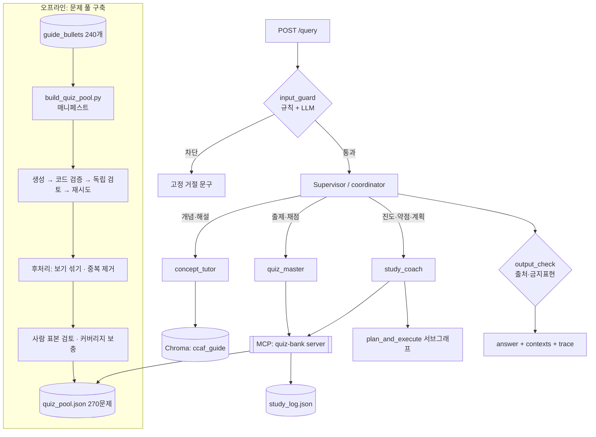

# DESIGN · CCA-F 학습 코치 (설계 v0.4)

> 기준 문서: Claude Certified Architect – Foundations Exam Guide (Version 0.2, 2026-06-30)
> 과제 규약: [Day 8,9,10] mini PJT 문서 §4 (산출물 규약), §5 (12개 패턴)
> 이 문서는 Claude Code에 넘기는 구현 기준 문서입니다. SERVICE.md가 "왜/누구를", 이 문서는 "어떻게"를 다룹니다.

**v0.4 변경 사항**
- **런타임 실시간 문제 생성 제거** (v2 목록에서도 삭제). 문제 생성은 오프라인 풀 구축에서만 수행
- **사전 생성 문제 풀 270문제**: 생성 단위를 TS에서 **세부 항목(Knowledge·Skills 불릿, 240개)**으로 변경. 세부 항목마다 1문제 + 도메인 비중으로 추가 30문제 (§5-2)
- 사람 표본 검토: 일반 문제 10% + 재시도 거친 문제 20% (약 35문제)
- 지표: 풀 적중률 삭제, 세부 항목 커버리지 추가
- 이전 변경: v0.3 구현 우선순위(P0 = `search_guide` + `get_quiz` + `submit_answer`), v0.2 문제 은행 MCP 서버·코드 채점

---

## 0. 시험 가이드에서 설계로 가져온 것 (요약)

| 가이드 내용 | 설계 반영 |
|---|---|
| 5개 도메인, 30개 Task Statement(TS 1.1~5.6) | **검색 청킹 단위 = TS 1개**. `domain`, `task_id`가 검색 필터, 출처 표기, 약점 추적의 공통 키 |
| 각 TS의 Knowledge of / Skills in 세부 항목 (총 240개) | **문제 생성 단위 = 세부 항목 1개**. 문제마다 어느 항목을 묻는지 지정해 중복 방지, 커버리지 측정 |
| 도메인 비중 27/18/20/20/15 (번호는 공식 가이드 기준: D2=Tool Design 18%, D3=Claude Code 20%) | 추가 30문제 배분, **런타임 출제 빈도**, 학습 시간 배분, 약점 점수 가중치 |
| 6개 시나리오와 각 시나리오의 primary domains | 문제마다 시나리오를 배정하되, 해당 도메인이 primary domain인 시나리오만 사용 |
| 문항 형식: 4지선다, 정답 1 + 그럴듯한 오답 3 | 퀴즈 Pydantic 스키마(보기 A~D, 정답 1개, 보기별 해설) |
| 샘플 문항 12개(정답·해설 포함) | 생성 few-shot 예시(형식·난이도 기준), 해설 질문의 근거 |
| Preparation Exercises 4개 | 학습 계획의 실습 과제 항목으로 연결 |
| In-scope / Out-of-scope 목록 | negative·edge 응답 근거 ("이건 시험 범위 밖") |
| TS 내용 자체 (hook 강제, 구조화 에러, 독립 검토, 배치 처리, 층화 표본, claim-source 매핑 등) | **이 앱의 구현 원칙으로도 적용** (§10-2) |

---

## 1. 범위

### 1-1. 구현 우선순위

| 단계 | 기한 | 범위 | 완료 기준 |
|---|---|---|---|
| **선행** | Day 8 오후 | `ingest.py`(청크 62개 + 세부 항목 240개) · `quiz_gen.py`(생성 → 코드 검증 → 독립 검토 → 재시도) · **파일럿 풀 10문제**(도메인당 2개) | `quiz_pool.json`에 승인 문제 10개 |
| **선행** | Day 8 저녁 | 파일럿 결과로 프롬프트 조정 후 **풀 전체 생성 시작** (약 40분, 백그라운드) | 기본 슬롯 240개부터 생성 진행 |
| **P0** | Day 9 오전 | 도구 3개: **`search_guide`**, **`get_quiz`**(MCP), **`submit_answer`**(MCP) · Supervisor + concept_tutor + quiz_master · `/query` (answer, contexts, trace) | "개념 질문 → 풀 출제 → 채점"이 `/query` 3회 호출로 한 바퀴 동작, 채점 결과가 `study_log.json`에 기록 |
| **P1** | Day 9 오후 (round1 전) | 풀 완성(270문제) + 사람 표본 검토 + 커버리지 부족 항목 보충 · 가드레일 G1~G7 · `get_chunk` · `get_progress`·`get_weak_domains` · study_coach(`allocate_study_time`, `make_study_plan`) · 평가 러너 | 20건 평가 실행 가능 |
| **v2** | Day 10 오전 (round2 개선 후보) 또는 제출 후 | `reset_progress` HITL · 장기 세션 요약 미들웨어 · 웹 UI | §9-4 참조 |

P0는 파일럿 풀만으로 검증 가능하므로 풀 전체 생성 완료를 기다리지 않음.
일정이 밀리면 덜어내는 순서: ① study_coach(학습 계획) → 테스트 7번은 round1 실패로 기록 ② 풀 추가 30문제 중 비중 낮은 도메인 몫 ③ 사람 표본을 도메인당 3문제로 축소.

### 1-2. 하지 않는 것 (이번 과제 범위 밖)
- 실제 시험 문항 재현·덤프 제공, 합격 예측
- **런타임 실시간 문제 생성** (제거. 풀이 부족한 범위는 오프라인 배치로 보충)
- 난이도별 출제 (단일 난이도)
- 가이드 외 문서(공식 SDK·MCP 문서 등) 코퍼스 확장
- LangSmith/LangFuse 연동 (로컬 trace로 대체, 시간 남으면 선택), Dockerfile (선택)
- 웹 UI는 v2 (1차 평가 후 결정, §13)

---

## 2. 코퍼스 설계

### 2-1. 청크 구성 (62개, 검색용)

| doc_type | 개수 | doc_id 예시 | 비고 |
|---|---|---|---|
| `overview` | 2 | `OV-details`, `OV-candidate` | 시험 형식, 대상 응시자 |
| `domain` | 5 | `D1` ~ `D5` | 도메인 이름·비중·소속 TS 목록 |
| `scenario` | 6 | `SC-1` ~ `SC-6` | 시나리오 설명 + primary domains |
| `task_statement` | 30 | `TS-1.1` ~ `TS-5.6` | Knowledge of + Skills in 전체 |
| `sample_question` | 12 | `SQ-01` ~ `SQ-12` | 문항 + 정답 + 해설 |
| `exercise` | 4 | `EX-1` ~ `EX-4` | 실습 단계 + 강화 도메인 |
| `scope` | 3 | `SCOPE-tech`, `SCOPE-in`, `SCOPE-out` | Appendix |

```python
class GuideChunk(BaseModel):
    doc_id: str                 # "TS-1.4"
    doc_type: Literal["overview","domain","scenario","task_statement",
                      "sample_question","exercise","scope"]
    domain: Optional[int]       # 1~5, 해당 없으면 None
    title: str
    page: Optional[int]
    guide_version: str = "0.2"
    text: str
```

### 2-2. 세부 항목 (240개, 문제 생성용)

각 TS의 "Knowledge of"와 "Skills in" 아래 불릿을 하나씩 분리. 검색 인덱스에는 넣지 않고 문제 생성 슬롯과 커버리지 측정에만 사용.

| 도메인 | TS 수 | Knowledge | Skills | 합계 |
|---|---|---|---|---|
| D1 | 7 | 24 | 24 | 48 |
| D2 | 5 | 20 | 23 | 43 |
| D3 | 6 | 23 | 26 | 49 |
| D4 | 6 | 22 | 25 | 47 |
| D5 | 6 | 24 | 29 | 53 |
| 합계 | 30 | 113 | 127 | **240** |

(TS당 6~10개. 가장 적은 TS 1.1은 6개, 가장 많은 TS 4.3은 10개. ingest 후 개수가 240과 다르면 파싱 오류로 보고 멈출 것)

```python
class GuideBullet(BaseModel):
    bullet_id: str              # "TS-1.4-K2", "TS-1.4-S3" (K=Knowledge, S=Skills, 순번)
    task_id: str
    domain: int
    kind: Literal["knowledge", "skill"]
    text: str
```

### 2-3. 청킹 방식
- PDF 텍스트를 헤더 패턴(`Task Statement x.y:`, `Scenario n:`, `Question n:`, `Exercise n:`)으로 **구조 분할**. TS 하나가 300~500 토큰이라 고정 길이 분할은 쓰지 않음.
- 페이지 머리말("Claude Certification Program  Exam guide") 제거. 페이지 경계에서 끊긴 불릿은 다음 줄과 이어 붙임.
- 산출물: `data/guide_chunks.jsonl`(62), `data/guide_bullets.jsonl`(240) → 청크만 Chroma 컬렉션 `ccaf_guide` 적재 (Titan v2 임베딩).

### 2-4. 저장 정책 (공개 repo)
- 가이드 PDF 원본(`data/raw/ccaf_exam_guide.pdf`), `guide_chunks.jsonl`, `guide_bullets.jsonl`은 **커밋하지 않음** (`.gitignore`). `data/README.md`에 PDF 배치 위치와 ingest 실행법만 기재.
- **문제 풀 `data/quiz_pool.json`은 커밋함**: 직접 생성한 원본 문제이고 근거 인용은 짧은 발췌만 포함. 평가 재현성 확보 목적.
- 미결정: 강사가 데이터 포함을 요구하면 청크 파일도 커밋 (§13).

### 2-5. 다국어 검색 이슈 (중요)
코퍼스는 영어, 질문은 한국어. BM25(kiwipiepy)는 한국어 질의로 영어 문서를 거의 못 찾음.
- v1: 질의를 영어 키워드로 재작성하는 `rewrite_query` 후 BM25 + 벡터 하이브리드 (Day 2 `hybrid.py`, `extra_multiquery.py` 재사용)
- `task_id`가 질문에 명시되면("TS 2.2", "도메인 3") 검색 대신 정확 조회
- round1 실패 원인 후보 1순위 → round2 개선폭을 만들 지점

---

## 3. 아키텍처



- LangGraph `create_supervisor` (Day 6) 기반. Supervisor는 질문 유형에 따라 **필요한 에이전트만** 호출 (TS 1.2).
- 복합 질문(개념 + 문제)은 순서대로 두 에이전트 호출 후 종합.
- handoff 시 필요한 정보(task_id, 시나리오, 직전 quiz_id)를 명시적으로 전달 (TS 1.3).
- 문제 생성 함수(`quiz_gen.py`)는 오프라인 스크립트에서만 호출하고 에이전트 도구로 노출하지 않음. 런타임에는 문제를 만들지 않음.

### 3-1. 에이전트와 도구 (에이전트당 도구 4개 이하, TS 2.3)

| 에이전트 | 역할 | 도구 (단계) | 출력 |
|---|---|---|---|
| `concept_tutor` | 개념 설명, 샘플 문항 해설, 범위 안내 | `search_guide(query, domain?, doc_type?)` **(P0)**, `get_chunk(doc_id)` (P1) | 답변 + claim-source 목록 |
| `quiz_master` | 출제, 채점 | `get_quiz` (MCP) **(P0)**, `submit_answer` (MCP) **(P0)** | 문제(정답 제외) / 채점 결과 |
| `study_coach` | 진도, 약점, 학습 계획 | `get_progress`, `get_weak_domains` (MCP, P1), `allocate_study_time`, `make_study_plan` (P1) | 진도 요약 / 학습 계획 |
| (general 응대) | 인사, 기능 안내 | 없음 | Day 6 `general_agent` 재사용 |

P0의 `search_guide`는 질문에 TS 번호가 있으면 내부에서 정확 조회로 처리 (`get_chunk`를 분리하기 전까지 임시).

도구 설명은 "언제 쓰고 언제 쓰지 않는지, 입력 형식, 예시 질의"를 포함해 작성 (TS 2.1).
- `get_quiz`: "문제 요청 시 사용. 도메인·TS·시나리오로 필터. 결과가 `no_match`면 문제를 만들지 말고 `alternatives` 중 하나를 사용자에게 제안."
- `submit_answer`: "사용자가 직전 문제의 답을 말했을 때만 사용. quiz_id는 대화 상태의 pending_quiz_id를 사용."

### 3-2. MCP 서버: `quiz_bank_server.py` (fastmcp, Day 4 구조 재사용)

| 도구 | 입력 | 출력 |
|---|---|---|
| `get_quiz` | user_id, domain?, task_id?, scenario_id? | 정답·해설을 **제외한** 문제(`QuizPublic`) 또는 `no_match` |
| `submit_answer` | user_id, quiz_id, choice | 채점 결과 + 보기별 해설. **채점과 기록 저장을 한 번에 수행** |
| `get_progress` | user_id | 도메인별 시도 수·정답률, 세부 항목 커버리지(푼 항목 수 / 240) |
| `get_weak_domains` | user_id, top_k=2 | 약점 점수 순 도메인 (점수 = 비중 × (1 − 정답률), 시도 3회 미만 도메인은 "데이터 부족") |
| `reset_progress` | user_id | **HITL interrupt 승인 후에만 실행** (v2, 패턴 7) |

- 저장소: `data/quiz_pool.json`(문제 은행, 읽기 전용), `data/study_log.json`(풀이 기록).
- MCP resource `quiz://catalog`: 도메인·TS·시나리오별 승인 문제 수 (탐색용 도구 호출 감소, TS 2.4)
- 에러는 구조화해서 반환 (TS 2.2):
  ```json
  {"isError": true, "errorCategory": "validation", "isRetryable": false,
   "message": "알 수 없는 quiz_id: Q-9.9-K1"}
  ```
- 조건에 맞는 문제가 없는 경우는 에러가 아니라 정상 결과 `{"status": "no_match", "reason": "...", "alternatives": [...]}`로 구분 (TS 2.2, 5.3). `alternatives`에는 조건을 하나 완화했을 때 가능한 조합(예: 같은 TS의 다른 시나리오)을 넣음.

---

## 4. 주요 스키마

```python
class Claim(BaseModel):                 # TS 5.6 claim-source 매핑
    claim: str
    doc_id: str                         # "TS-4.3"
    excerpt: str                        # 근거 원문 일부 (영문 그대로)

class TutorAnswer(BaseModel):
    answer_ko: str
    claims: list[Claim]
    in_exam_scope: Literal["in", "out", "unclear"]   # TS 4.3 "unclear" enum 패턴
    coverage_gap: Optional[str] = None  # 가이드에 근거가 없을 때 무엇이 없는지

class QuizOption(BaseModel):
    label: Literal["A","B","C","D"]
    text: str
    rationale: str                      # 왜 정답/오답인지

class QuizItem(BaseModel):              # 문제 은행 저장 형식 (정답 포함)
    quiz_id: str                        # "Q-1.4-K2" (기본 슬롯) / "Q-1.4-X1" (추가 슬롯). 배치의 custom_id 역할
    task_id: str
    domain: int
    focus_bullet_ids: list[str]         # 기본 슬롯 1개, 추가 슬롯 2개 (같은 TS 내 두 항목 결합)
    scenario_id: int                    # 1~6
    stem: str
    options: list[QuizOption]           # 정확히 4개 (validator로 강제)
    answer: Literal["A","B","C","D"]
    source_excerpt: str
    # 운영 메타데이터
    status: Literal["approved", "rejected", "duplicate", "needs_fix"]
    review_retries: int                 # 0~2
    detected_patterns: list[str]        # 검토 실패 유형 기록 (TS 4.4)
    human_checked: bool = False
    generator_model: str
    guide_version: str = "0.2"
    created_at: str

class QuizPublic(BaseModel):            # LLM과 사용자에게 내보내는 형식 (정답 없음)
    quiz_id: str
    task_id: str
    scenario_id: int
    stem: str
    options: list[dict]                 # label, text만

class ReviewVerdict(BaseModel):         # 독립 검토 결과
    valid: bool
    issues: list[str]                   # "정답 근거가 TS-1.4-K2에 없음", "B도 정답으로 해석 가능" 등
    detected_pattern: Optional[Literal[
        "answer_not_supported", "multiple_correct", "distractor_obviously_wrong",
        "off_focus_bullet", "out_of_scope", "scenario_mismatch", "other"]]

class GradeResult(BaseModel):
    quiz_id: str
    choice: str
    correct: bool
    answer: str
    option_rationales: dict[str, str]
    task_id: str

# ---- 오프라인 풀 구축용 (§5-2) ----
class QuizDraft(BaseModel):             # 생성 LLM 출력. validator 없음 → 형식 오류는 코드 검증이 재시도 피드백으로 변환
    stem: str
    options: list[QuizOption]
    answer: Literal["A","B","C","D"]
    source_excerpt: str                 # 초점 세부 항목 원문의 연속 구간 (코드로 확인)

class QuizOptionsRepair(BaseModel):     # 길이 repair 출력. options만 받아 원본 draft에 끼움 (stem·answer·source_excerpt 유지)
    options: list[QuizOption]

class ManifestSlot(BaseModel):          # data/quiz_pool_manifest.json의 슬롯 하나
    quiz_id: str
    slot_type: Literal["base", "extra", "fill"]
    task_id: str
    domain: int
    focus_bullet_ids: list[str]
    scenario_id: int                    # scenario_mismatch 재시도 시 다음 후보로 갱신
    scenario_candidates: list[int]      # 도메인 배정 시나리오 목록
    target_answer: Literal["A","B","C","D"]   # 보기 섞기 후 정답 위치 (균등 배정)
    order: int                          # 생성·중복 판정 순서: 기본 → 추가 → 보충
    pilot: bool = False
    status: Literal["pending", "approved", "rejected", "duplicate"] = "pending"
    attempts: int = 0                   # 생성 호출 수 0~3 (QuizItem.review_retries = attempts - 1)
    repairs: int = 0                    # 길이 repair 호출 수 (attempts에 포함하지 않음)
    repairs_ok: int = 0                 # repair 후 코드 검증을 통과한 수
    detected_patterns: list[str] = []   # 시도별 실패 유형 (parse, code, 검토 패턴, duplicate_of:Q-…)
    last_errors: list[str] = []         # 마지막 실패의 구체적 오류
    prompt_version: Optional[str]       # src/prompts 파일들의 sha1 앞 8자리
    updated_at: Optional[str]

class QuizManifest(BaseModel):
    manifest_version: int = 1
    guide_version: str
    generator_model: str
    created_at: str
    updated_at: str
    summary: dict[str, int]             # 상태별 슬롯 수 (저장할 때마다 재계산)
    slots: list[ManifestSlot]
```

`QuizItem` validator: options 정확히 4개, 라벨 {A,B,C,D} 각 1회, answer ∈ 라벨, review_retries 0~2.

State 확장 (Supervisor 그래프 messages 외):
- `pending_quiz_id: Optional[str]` — 다음 턴 채점용. **정답은 State에 두지 않음**. checkpointer(thread_id)에 저장
- `case_facts: dict` — 시험일, 목표 도메인 등 요약에 묻히면 안 되는 사실 (TS 5.1)
- 장기 기억(Store, namespace `("users", user_id)`): 시험 예정일, 선호 언어, 최근 약점 스냅샷

---

## 5. 핵심 흐름

### 5-1. 개념 Q&A
1. `rewrite_query`: 한국어 질문 → 영어 키워드 질의 (+ TS 번호 감지)
2. `search_guide` 하이브리드 검색 k=4 (도메인 힌트 있으면 필터)
3. `TutorAnswer` 구조화 출력. claims가 비면 답을 지어내지 않고 `coverage_gap`으로 "가이드에 없음" 안내
4. 답변 끝에 출처 표기: `[근거: TS-1.4, SQ-01]`

### 5-2. 문제 풀 사전 생성 (오프라인, `scripts/build_quiz_pool.py`)

**규모와 배분: 승인 문제 270개**
- **기본 슬롯 240개**: 세부 항목마다 1문제 (그 항목 하나를 판단 근거로 삼는 문제)
- **추가 슬롯 30개**: 도메인 비중으로 배분. 같은 TS 안 세부 항목 2개를 결합한 판단형 문제. 세부 항목 수가 적은 TS부터 배정

| 도메인 | 비중 | 세부 항목(기본) | 추가 | 합계 | 배정 시나리오 |
|---|---|---|---|---|---|
| D1 Agentic Architecture | 27% | 48 | 8 | 56 | SC-1, SC-3, SC-4 |
| D2 Tool Design & MCP | 18% | 43 | 5 | 48 | SC-1, SC-3, SC-4 |
| D3 Claude Code | 20% | 49 | 6 | 55 | SC-2, SC-4, SC-5 |
| D4 Prompt Eng. & Structured Output | 20% | 47 | 6 | 53 | SC-5, SC-6 |
| D5 Context & Reliability | 15% | 53 | 5 | 58 | SC-1, SC-2, SC-3, SC-6 |
| 합계 | | 240 | 30 | **270** | |

- 풀 구성은 시험 비중과 일치하지 않음(D1 21%, D5 21%). 풀은 **빠짐없이 다루는 것**을 맡고, 실제 **출제 빈도는 `get_quiz`가 시험 비중 × 약점으로 조절** (§5-3).
- 시나리오는 도메인의 primary 시나리오 목록에서 TS 안 순서대로 순환 배정. 검토에서 `scenario_mismatch`가 나오면 재시도 때 목록의 다음 시나리오로 바꿈.
- 예외: 세부 항목 원문이 특정 시나리오를 전제하면 시작 시나리오를 고정 (`build_quiz_pool.SCENARIO_OVERRIDES`. 순환 위치는 그대로 진행해 다른 슬롯 배정은 불변). 현재 `TS-1.4-S2`("multi-concern customer requests") → SC-1. 파일럿에서 SC-3·SC-4로 두 번 `scenario_mismatch` 탈락한 사례

**생성 절차**
1. **매니페스트 작성**: 슬롯 270개(`quiz_id`, task_id, focus_bullet_ids, scenario_id)를 `data/quiz_pool_manifest.json`에 기록. 슬롯 상태(pending/approved/rejected)를 갱신하므로 중단돼도 `--resume`으로 미완료 슬롯만 이어서 생성 (TS 4.5 custom_id 재제출, TS 5.4 manifest 기반 복구)
2. **파일럿 10문제**(도메인당 2개)로 생성·검토 프롬프트를 먼저 다듬음 (TS 4.5: 대량 처리 전 표본으로 프롬프트 개선)
3. **생성 순서**: 기본 슬롯 240개를 먼저 전 도메인에 걸쳐 생성하고, 그다음 추가 슬롯 30개 (중간에 멈춰도 커버리지 우선 확보)
4. **슬롯별 생성**: 해당 TS 청크 + 초점 세부 항목 + 시나리오 청크 + 샘플 문항 2개 few-shot → `quiz_gen.generate()` (TS 4.2)
5. **코드 검증**(Pydantic): 보기 4개, 라벨 중복 없음, 정답 라벨 존재, task_id·bullet_id·scenario_id 실재
6. **독립 검토**: `quiz_reviewer`는 생성 추론 없이 문항 + 근거 청크 + 초점 세부 항목만 받아 판정 (TS 4.6)
7. **재시도**: 실패 시 근거 + 실패한 문항 + 구체적 오류를 붙여 재생성, 최대 2회 (TS 4.4). 그래도 실패하면 `rejected`로 남기고 `detected_patterns` 기록
8. 동시 실행 4개, Bedrock throttling 시 지수 백오프

**구현 세부 규칙 (v0.4.1, 구현 시 합의)**
- **문항 언어**: stem·options는 영어(실제 시험·few-shot과 동일), rationale은 한국어 + 영어 용어 병기, source_excerpt는 가이드 영문 원문 그대로
- **추가 슬롯 쌍** (v0.4.2): 같은 TS의 K×S 쌍 중 **키워드 겹침이 가장 큰 쌍**을 고르고, 같은 TS에 2개를 배정하면 이미 쓴 쌍은 피함 (`quiz_gen.pair_extra_bullets`). 키워드 = 소문자 토큰 3자 이상 − 불용어, 간이 어간(-ing/-es/-s/-ed). 점수: 겹친 수 → Jaccard → 아직 안 쓴 불릿 수 → (K, S 번호) 오름차순. quiz_id `Q-x.y-Xj`, 시나리오는 그 TS의 순환을 이어서 배정. `--dry-run`이 쌍별 겹친 키워드를 출력 (현재 30쌍 모두 4~11개 겹침). v0.4.1의 `K_j + S_j` 고정 규칙은 관련 없는 쌍이 나와 폐기
- **few-shot**: 슬롯 시나리오의 SQ 2개(quiz_id 시드). SQ가 없는 SC-4·SC-6은 도메인 시나리오 목록 순서로 채움
- **코드 검증 세부 패턴** (v0.4.2, `detected_patterns`에 `code` 대신 기록. 위가 더 심각하며, 시도 하나의 대표 패턴은 이 순서로 고름):

  | 패턴 | 조건 |
  |---|---|
  | `format` | 보기 4개·라벨 A~D 각 1회·정답 라벨 존재·보기 텍스트 중복 없음·빈 값 없음·stem 길이 |
  | `unknown_ref` | task_id·bullet_id·scenario_id 실재 |
  | `excerpt_not_verbatim` | source_excerpt가 TS 원문 한 줄의 부분 문자열인지 (초점 적합성은 검토자 `off_focus_bullet`이 판정) |
  | `language` | stem·options에 한글 없음, rationale은 한국어 |
  | `label_reference` | 보기를 라벨로 가리키는 표현 금지 (보기를 섞으면 라벨이 바뀌므로 해설은 자기 내용만 설명) |
  | `meta_reference` | 해설에 내부 용어("focus item", "task statement", source_excerpt) 금지 |
  | `forbidden_phrase` | "all/none of the above", stem·보기에 가이드·TS 번호 언급 금지 |
  | `answer_too_long` | **정답 길이 단서 방지**: 정답 보기 길이 ≤ 오답 평균 × 1.25 그리고 ≤ 가장 긴 오답 × 1.15 (파일럿에서 정답이 가장 긴 보기인 비율 8/10 → 규칙 도입 후 약 4/9) |
- **길이 repair** (v0.4.2): 한 생성 시도의 코드 검증 오류가 **전부 `answer_too_long`**이면 재생성 대신 보기만 고치는 repair를 **시도마다 1회** 호출 (`src/prompts/quiz_repair.md`, 출력 `QuizOptionsRepair`)
  - 입력: TS 원문 + 초점 항목 + 문항 + 길이 수치(정답·오답 평균·가장 긴 오답). 지시: 지문과 정답 보기는 유지, 정답은 의미를 유지한 채 "왜 좋은지" 설명구를 rationale로 옮기고, 오답은 같은 구조·구체성으로 맞춤
  - 코드로 options만 원본 draft에 끼움(stem·answer·source_excerpt 불변, 라벨 집합이 바뀌면 거부) → 코드 검증 다시 → 통과하면 **반드시 독립 검토**로 진행 (정답 의미가 바뀌었으면 검토에서 걸림)
  - repair는 attempts(생성 호출 수)에 넣지 않음. 매니페스트 `repairs`·`repairs_ok`, 성공 시 detected_patterns에 `answer_too_long:repaired` 기록. repair 후에도 실패하면 그 시도는 실패로 처리하고 피드백에 "repair 후에도 실패"를 명시
- **생성 프롬프트 길이 균형 지침** (v0.4.2): 정답을 먼저 쓰고 오답 3개를 같은 문장 구조(행동 + 수단 + 범위)·같은 수준의 세부로 작성, 보기당 약 15~30단어, 정답에만 "왜 좋은지" 설명구를 붙이지 않음(해설로), 반환 전 길이 비교
- **재시도 피드백**: 원래 생성 프롬프트 전체 + 실패 문항 JSON + 문제점 목록(`[parse]`/`[code:세부 패턴]`/`[review:패턴]`) + 패턴별 고정 지시문(`src/prompts/FIX_HINTS`, 코드 세부 패턴별로 분리) + 이전 시도 요약 한 줄씩. `scenario_mismatch`면 다음 후보 시나리오로 바꾸고 그 사실을 피드백에 명시 (마지막 시도 뒤에는 바꾸지 않음)
- **프롬프트 변경 후 재생성** (`--reset-stale`, LLM 호출 없음): 현재 `prompt_version`과 다른 버전으로 처리된 슬롯을 되돌림. base/extra는 pending으로 초기화(attempts·repairs·detected_patterns·last_errors, 시나리오는 원래 배정값), fill 슬롯은 삭제, pool에서 해당 문항 제거. 자동 리셋은 하지 않고(전체 생성 도중 진행분 보호) 실행 시 오래된 버전 슬롯 수를 경고로 출력
- **매니페스트 동기화**: 슬롯 배정 규칙이 바뀌면 pending 슬롯의 정의(focus_bullet_ids, scenario_candidates)는 자동 갱신, 처리된 슬롯의 정의가 바뀌었으면 오류(`--reset-stale` 후 재실행)
- **Bedrock 일시 오류**(throttling 등)는 지수 백오프(최대 6회)로 처리하고 재시도 횟수에 넣지 않음. 그래도 실패하면 슬롯은 pending으로 남음
- **저장**: 코드 검증을 통과한 문항만 `quiz_pool.json`에 저장(approved / 검토 탈락 rejected / duplicate). 코드 검증 단계에서 끝난 rejected는 매니페스트에만 기록
- **파일럿**(`--pilot N`)은 실행할 때마다 해당 슬롯을 새로 생성(프롬프트 조정 반복용)

**후처리 (코드)**
- **보기 섞기**: LLM은 정답을 특정 위치에 몰아 두는 경향이 있으므로, 정답 보기를 슬롯의 `target_answer` 위치에 놓고(A~D 균등 리스트 68/68/67/67을 고정 시드로 섞어 슬롯 순서대로 배정, 보충 슬롯은 quiz_id 해시) 오답 3개는 `quiz_id`를 시드로 섞은 뒤 라벨을 다시 매핑. 결과 정답 분포가 A~D 각 20~30%인지 확인
- **중복 제거**: 같은 TS 안에서 지문 임베딩 코사인 유사도 0.92 이상이면 뒤 문제(order 기준: 기본 → 추가 → 보충)를 `duplicate` 처리. 매 실행 끝에 수행

**커버리지 보충 (`--fill-gaps`)**
- **가드** (v0.4.2): pending인 base/extra 슬롯이 하나라도 남아 있으면 거부하고 종료 코드 1 (우회 옵션 없음). 기본 커버리지가 끝나기 전에 보충 슬롯이 생겨 한 항목에 문제가 2개 생기는 것을 막음
- 승인 문제가 없는 세부 항목만 골라 새 슬롯(`Q-x.y-K2-F`)으로 1회 더 생성. 세부 항목당 최대 2슬롯(기본 + 보충). 보충 슬롯 프롬프트에는 같은 TS의 승인 문항 지문을 "반복 금지"로 넣음
- 보충 슬롯 시나리오: 직전 슬롯이 마지막에 시도한 시나리오를 재사용. 단 마지막 실패가 `scenario_mismatch`이거나 중복이면 다음 후보
- 커버리지 = 승인 문항의 focus_bullet_ids에 한 번이라도 들어간 세부 항목 (추가 슬롯 승인도 인정). 아직 pending 슬롯이 있는 항목은 보충 대상이 아님
- 목표: 세부 항목 커버리지 95% 이상 (240개 중 228개 이상)

**사람 표본 검토 (TS 5.5 층화 표본)**
- 도메인별로 **재시도 없이 통과한 문제의 10% + 재시도 거친 문제의 20%** 무작위 추출 (약 35문제). 재시도 문제는 오류 가능성이 높아 표본 비율을 높임
- 오류 발견 시 해당 문제 `needs_fix`, 같은 유형이 한 도메인에서 2건 이상이면 그 도메인 프롬프트 수정 후 재생성
- 결과 문서: `evaluation/quiz_pool_report.md` (도메인·시나리오별 승인 수, 세부 항목 커버리지, 승인율, 실패 유형 분포, 정답 위치 분포, 중복 제거 수, 사람 검토 오류율)

**예상 규모 (가정)**: 생성 슬롯 약 320개(재생성 포함), LLM 호출 약 820회, 동시 4개 기준 약 40분. 계산 근거는 `docs/quiz_generation_options.xlsx`. 과정 공용 Bedrock 키의 할당량 제한 가능성이 있어 Day 8 저녁에 시작

### 5-3. 퀴즈 출제 (런타임)
1. `get_quiz(user_id, domain?, task_id?, scenario_id?)` 호출
   - 조건에 맞고 사용자가 아직 풀지 않은 `approved` 문제 중 하나를 정답 없이 반환
   - 조건이 없으면 도메인을 **시험 비중 × 약점 점수** 비례로 고르고(기록 부족 시 시험 비중만), 그 도메인 안에서는 사용자가 아직 안 푼 세부 항목을 우선
2. `no_match`이면 문제를 지어내지 않고 "해당 조합의 문제가 없다"고 밝힌 뒤 `alternatives` 중 하나로 대체 문제를 제안하거나 바로 출제
3. 사용자에게 지문과 보기만 보여주고 `pending_quiz_id` 저장

`no_match`가 나는 경우: 풀 배정 규칙상 없는 TS·시나리오 조합 요청(예: D1 소속 TS-1.7을 SC-5 CI 상황으로), 해당 범위 문제를 사용자가 모두 푼 경우.

### 5-4. 채점
"답은 B" 또는 UI 보기 클릭 → `pending_quiz_id` 확인 → `submit_answer`(MCP)가 문제 은행의 정답으로 **코드 채점 + 기록 저장** → quiz_master가 보기별 해설을 한국어로 정리. `pending_quiz_id`가 없으면 "채점할 문제가 없다"고 안내.

채점을 LLM 판단이 아니라 코드로 하고, 기록 저장을 같은 도구 안에 묶어 "채점은 했는데 기록이 빠지는" 경우를 없앰 (TS 1.4 프로그램적 강제).

### 5-5. 학습 계획 (Plan-Execute, Day 7 재사용)
1. `get_progress` / `get_weak_domains`
2. `allocate_study_time(days, hours_per_day, weights, accuracy)` → 결정적 계산 (LLM 계산 금지)
3. planner → execute(일자별 TS 배정 + 관련 Exercise 연결 + 해당 TS의 남은 문제 수 안내) → replan → finalize
4. 시험일은 Store/`case_facts`에서 읽음. 없으면 묻기

---

## 6. 가드레일 (코드로 강제, 프롬프트 의존 최소화 · TS 1.4/1.5 원칙)

| # | 규칙 | 위치 | 구현 |
|---|---|---|---|
| G1 | 실제 시험 문항·덤프·기출 요청 거절, 대신 원본 연습 문제 제안 | 입력 | 정규식(`덤프`, `기출`, `실제 (시험)?문제`, `exam dump`, `real questions`) + LLM 판별 |
| G2 | 프롬프트 인젝션·시스템 프롬프트 요구 차단 | 입력 | Day 5 `guards_input.py` 재사용 |
| G3 | 출처 없는 단정 금지: 개념 답변은 claims ≥ 1, 아니면 "가이드 근거 없음" 응답으로 대체 | 출력 | `TutorAnswer` 검증 후 분기 |
| G4 | 공식·제휴 사칭, 합격 보장 표현 금지 (`공식 튜터`, `합격 보장`) | 출력 | 금지어 검사 + 고정 고지 문구 |
| G5 | 범위 밖 주제(Claude 시험과 무관한 질문)는 한 줄 안내 후 종료 | 입력/라우팅 | Supervisor 배분 기준 + general 응대 |
| G6 | 채점 전 정답 노출 금지 | 도구 | `get_quiz`는 `QuizPublic`만 반환. 정답은 `submit_answer`에서만 공개 |
| G7 | 검토를 통과하지 못한 문제는 출제 금지, 런타임에 문제를 만들지 않음 | 도구 | `get_quiz`는 `approved`만 반환. 풀에 없으면 안내 + 대체 제안 |

고정 거절 문구는 Day 5 `guards_refusal.py` 방식으로 상수화 (평가 시 문자열 매칭 가능하게).

---

## 7. API 규약 매핑

```
POST /query
Body: {"question": "...", "user_id": "demo_user"?, "thread_id": "..."?}   # 뒤 2개는 선택, 기본값 있음
Response: {"answer": "...", "contexts": [{"doc_id": "TS-1.4", "text": "..."}], "trace": [...]}
```
- `contexts`: `search_guide`/`get_chunk` 결과와, 출제 시에는 해당 문제의 근거 TS 발췌를 콜백으로 수집 (Day 7 `run_eval.py`의 ToolRecorder 방식)
- `trace`: step 단위 `guard → route(agent) → rewrite → retrieve → get_quiz → submit → output_check`. Day 7 `local_tracer.py` 확장
- 서버: FastAPI (Day 6 `api_server.py` 재사용, 경로만 `/query`로 변경)

---

## 8. 데이터 파일

| 파일 | 내용 | 커밋 |
|---|---|---|
| `data/raw/ccaf_exam_guide.pdf` | 시험 가이드 원본 | X |
| `data/guide_chunks.jsonl` | 검색용 청크 62개 | X |
| `data/guide_bullets.jsonl` | 세부 항목 240개 | X |
| `data/quiz_pool.json` | 문제 은행 (`QuizItem` 270개 목표) | O |
| `data/quiz_pool_manifest.json` | 생성 슬롯과 상태 (재개·보충용) | O |
| `data/study_log.json` | 풀이 기록. 더미 사용자 `demo_heavy`(기록 많음), `demo_new`(기록 없음) 시드 | O |

`study_log.json` 시드는 풀이 완성된 뒤 실제 `quiz_id`를 참조해 생성 (`scripts/seed_study_log.py`).

---

## 9. 평가 설계

### 9-1. 인-아웃 세트 (`evaluation/test_queries.csv`, 20건)
- 비율: positive 8 / negative 4 / edge 5 / guardrail 3 (= 40/20/25/15%)
- 판정 (case PASS 조건):
  1. `expected_tools`가 모두 호출됨 (ToolRecorder). `;`는 "모두 호출", `|`는 "그중 하나 이상 호출"(예: `search_guide|get_chunk`). 빈 값이면 도구 호출 0건이어야 PASS (guardrail 차단 문항)
  2. `forbidden` 항목이 답변에 없음 (문자열 + LLM judge)
  3. `expected_traits`를 LLM judge가 항목별로 충족 판정 (전부 충족해야 PASS)
- 문항 5는 풀 출제, 문항 13은 풀에 없는 조합 요청 시 문제를 지어내지 않고 안내 + 대체 문제를 제안하는지 검증. 둘 다 출제 응답까지만 판정
- 문항 7(학습 계획)은 기록이 있는 더미 사용자 `demo_heavy`로 실행
- P0 한 바퀴 검증은 CSV와 별도로 `evaluation/smoke_p0.py`(개념 질문 → 출제 → 채점 3턴, 같은 thread_id)로 확인
- Judge: Bedrock Claude Sonnet 4.5, temperature 0, 루브릭 고정 (Day 7 `llm_judge.py` 확장)

### 9-2. RAGAS
- 대상: 근거 검색이 있는 문항만 (`evaluation/ragas_reference.csv`의 `ragas=Y`, 14건). 출제·학습 계획·가드레일 차단 문항은 judge로만 평가
- 지표: context_recall, context_precision, faithfulness, answer_relevancy
- reference는 가이드 원문 근거로 사람이 작성 (순환 평가 방지)
- RAGAS LLM/임베딩도 Bedrock 래퍼로 연결. **Day 9 오전에 3건짜리 스모크 테스트**
- 주의: 가이드는 영어, 답변은 한국어 → answer_relevancy가 낮게 나올 수 있음. 필요하면 답변에 영어 핵심 용어 병기

### 9-3. 문제 풀 품질 지표 (round 리포트에 함께 기재)
- 승인 문제 수 (목표 270, 최소 250), 세부 항목 커버리지 (목표 95% 이상)
- 승인율(승인 ÷ 생성 슬롯), 실패 유형 분포: 검토 패턴(`detected_pattern`) + 코드 검증 세부 패턴(`format`, `excerpt_not_verbatim`, `answer_too_long` 등, §5-2)을 함께 집계. `answer_too_long:repaired`(repair로 복구)는 따로 셈
- 길이 repair 성공률 (`repairs_ok ÷ repairs`)
- 사람 표본 검토 오류율 (목표 0건, 최대 1건)
- 정답 위치 분포 (A~D 각 20~30%), 중복 제거 수
- **정답이 가장 긴 보기 비율** (승인 문항 기준, 동률은 가장 긴 것으로 침. 목표 35% 이하, 우연 수준 25%, 길이 규칙 도입 전 파일럿 80%)
- 런타임 `no_match` 비율 (평가·시연 중 출제 요청 대비)

### 9-4. round2 개선 후보 (round1 결과 보고 2~3개 선택)
1. 질의 재작성(한→영) + TS 번호 직접 조회 보강
2. 도구 설명 보강 / 오라우팅 사례 few-shot 추가 (concept_tutor ↔ quiz_master 배분)
3. `search_guide` 결과 트리밍 (Knowledge/Skills 중 관련 부분만, TS 5.1)
4. `detected_pattern` 집계 기반 생성 프롬프트 수정 후 취약 도메인 재생성
5. reranker 추가 (Day 2 `rerank_demo.py`)

---

## 10. 매핑표

### 10-1. 과제 12개 패턴

| # | 패턴 | 적용 위치 | 우선순위 |
|---|---|---|---|
| 1 | LCEL + Pydantic 구조화 출력 | `TutorAnswer`, `QuizItem`, `ReviewVerdict` | 필수 |
| 2 | ReAct | 각 하위 에이전트 (`create_react_agent`) | v1 |
| 3 | RAG (하이브리드·쿼리 확장) | `search_guide` | 필수 |
| 4 | 도구 다중 | 검색 + 계산기 + MCP | v1 |
| 5 | MCP 서버 | `quiz_bank_server.py` (문제 은행 + 학습 기록) | v1 |
| 6 | 가드레일 | G1~G7 | v1 |
| 7 | HITL | `reset_progress` 승인 | v2 |
| 8 | 미들웨어 | 장기 세션 요약 + `case_facts` 보존 | v2 |
| 9 | Multi-Agent Supervisor | 전체 구조 | v1 |
| 10 | Plan-Execute + 장기 메모리 | 학습 계획, Store | v1 |
| 11 | Trace | `/query` trace, jsonl 로그 | 필수 |
| 12 | 평가 (RAGAS · Judge) | §9 | 필수 |

v1만으로 10개 패턴(1~6, 9~12) 충족. 권장 기준(6개 이상)과 필수 4개 모두 만족.

### 10-2. 시험 개념을 앱 구현에 적용한 지점 (README "활용한 패턴"에 같이 기재)

| 시험 TS | 앱에서 적용한 곳 |
|---|---|
| 1.2 coordinator가 필요한 에이전트만 선택 | Supervisor 배분 기준 |
| 1.3 하위 에이전트에 컨텍스트 명시 전달 | handoff 시 task_id·시나리오·quiz_id 전달 |
| 1.4 / 1.5 프롬프트 대신 코드로 강제 | 가드레일, 코드 채점 + 기록 일체화(`submit_answer`), 정답 비노출 |
| 2.1 도구 설명으로 선택 정확도 확보 | 도구 docstring 작성 규칙 |
| 2.2 / 5.3 구조화 에러, 빈 결과와 실패 구분 | MCP 응답 형식, `no_match` |
| 2.3 에이전트당 도구 4~5개 이하 | §3-1 |
| 2.4 MCP resource로 카탈로그 노출 | `quiz://catalog` |
| 4.2 few-shot | 샘플 문항 기반 생성 |
| 4.3 nullable·enum으로 날조 방지 | `coverage_gap`, `in_exam_scope="unclear"`, `detected_pattern` enum |
| 4.4 오류 피드백 재시도, 실패 유형 추적 | 생성 재시도 루프, `detected_patterns` |
| 4.5 지연 허용 작업의 배치 처리, custom_id 기반 재제출, 표본으로 프롬프트 개선 | 풀 사전 생성, 매니페스트·`--resume`·`--fill-gaps`, 파일럿 10문제 |
| 4.6 독립 인스턴스 검토 | `quiz_reviewer` |
| 5.1 핵심 사실 보존 | `case_facts`, 도구 결과 트리밍 |
| 5.4 manifest 기반 복구 | 생성 중단 시 미완료 슬롯만 재개 |
| 5.5 층화 표본 검토, 세그먼트별 정확도 확인 | 도메인별 층화 표본(재시도 문제 가중), 도메인별 승인율·커버리지 |
| 5.6 claim-source 매핑 | `Claim`, 답변 출처 표기 |

LangGraph는 시험의 Claude Agent SDK와 다른 프레임워크이므로, 용어 대응(Supervisor ≈ coordinator, handoff 도구 ≈ Task tool, 도구 내부 검증·노드 분기 ≈ hook)을 README에 한 줄로 밝힘. 풀 생성은 Bedrock 동기 호출을 병렬로 돌리는 방식이며 Message Batches API 자체를 쓰지는 않음.

---

## 11. 폴더 구조 (과제 §4-1 준수)

```
mini-pjt_{이름}/
├── src/
│   ├── config.py              # 상위 폴더 ..\.env 로드, 모델 ID·리전·경로 상수
│   ├── agent.py               # Supervisor 그래프 조립 (build_app)
│   ├── agents/                # concept_tutor.py, quiz_master.py, study_coach.py
│   ├── tools.py               # search_guide, get_chunk, allocate_study_time
│   ├── quiz_gen.py            # 생성 → 검증 → 독립 검토 → 재시도 (오프라인 전용)
│   ├── prompts/               # 문제 생성·검토 프롬프트
│   ├── retriever.py           # 하이브리드 검색 + rewrite_query
│   ├── schemas.py             # §2, §4 Pydantic 모델
│   ├── guards.py              # G1~G7
│   ├── planner.py             # Plan-Execute 서브그래프
│   ├── tracer.py              # trace 수집
│   ├── ingest.py              # PDF → 청크 62개 + 세부 항목 240개 → Chroma
│   ├── quiz_bank_server.py    # MCP 서버 (문제 은행 + 학습 기록)
│   └── api.py                 # FastAPI /query
├── scripts/
│   ├── build_quiz_pool.py     # 문제 풀 사전 생성 (--pilot, --resume, --fill-gaps)
│   ├── review_sample.py       # 층화 표본 추출 → 사람 검토용 CSV
│   └── seed_study_log.py      # 더미 풀이 기록 생성
├── data/
│   ├── README.md              # 가이드 PDF 배치·ingest 방법 (PDF 자체는 미커밋)
│   ├── raw/                   # ccaf_exam_guide.pdf (미커밋)
│   ├── quiz_pool.json
│   ├── quiz_pool_manifest.json
│   └── study_log.json
├── evaluation/
│   ├── test_queries.csv
│   ├── ragas_reference.csv
│   ├── run_eval.py
│   ├── smoke_p0.py            # P0 한 바퀴 검증 (3턴)
│   ├── quiz_pool_report.md
│   ├── round1_report.md
│   └── round2_report.md
├── docs/
│   ├── DESIGN.md
│   └── quiz_generation_options.xlsx
├── CLAUDE.md
├── SERVICE.md
├── requirements.txt           # + ragas, fastapi, uvicorn, pypdf
├── README.md
└── Dockerfile                 # 선택
```

---

## 12. 일정

| 시점 | 할 일 | 완료 기준 |
|---|---|---|
| Day 8 오후 | SERVICE.md, test_queries.csv 확정(18:00 진도 공유) · `ingest.py` · `quiz_gen.py` · **파일럿 풀 10문제** | 청크 62개, 세부 항목 240개, 승인 문제 10개 |
| Day 8 저녁 | 파일럿 결과로 프롬프트 조정 → **풀 전체 생성 시작** (`--resume`로 이어서 가능) | 기본 슬롯 240개 진행 |
| Day 9 09~12시 | **P0**: `search_guide` · MCP `get_quiz`·`submit_answer` · Supervisor + 2개 에이전트 · `/query` · `smoke_p0.py` · RAGAS 3건 스모크 테스트 · (생성 미완료 시 `--resume` 병행) | 한 바퀴 동작 (§1-1) |
| Day 9 13~15시 | `--fill-gaps` · 사람 표본 검토(약 35문제) · `quiz_pool_report.md` · `seed_study_log.py` · 가드레일 | 승인 250개 이상, 커버리지 95% 이상, 표본 오류 0~1건 |
| Day 9 15~18시 | P1 나머지: `get_chunk`, 진도·약점, study_coach, 평가 러너 | 20건 실행 가능 |
| Day 9 종료 | round1 평가 → `round1_report.md` | 통과율·RAGAS·풀 지표 기록 |
| Day 10 오전 | round2 개선 2~3건 → `round2_report.md`, README, 시연 캡처 | 15:00 제출 |

---

## 13. 미결정 사항

1. 가이드 원문/청크 파일을 repo에 포함할지 (기본값: 미포함, 문제 풀은 포함)
2. 웹 UI 범위 (v2. 후보: 단일 HTML 페이지. 1차 평가 후 결정)
3. 답변 언어: 한국어 설명 + 영어 핵심 용어 병기 (기본값)
